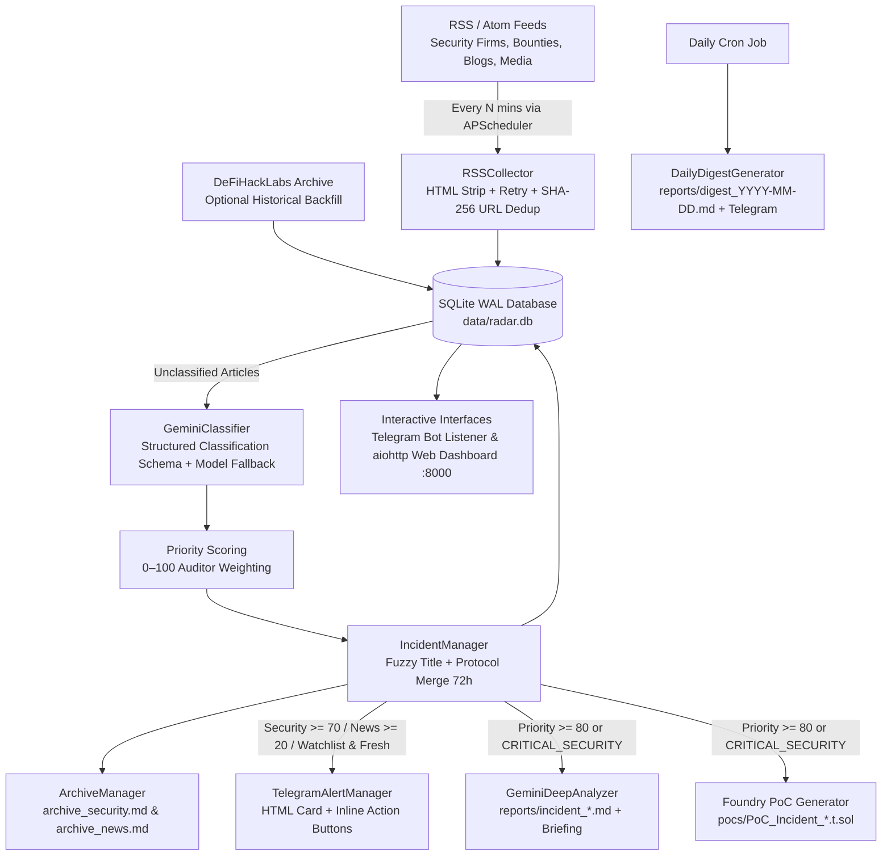

# 🛡️ Web3 Security Radar

[](https://github.com/reverb006/WEB3_News_Bot/actions/workflows/ci.yml)
[](https://www.python.org/downloads/)
[](LICENSE)

An autonomous, self-hosted **Web3 security & ecosystem intelligence pipeline** built for smart-contract security auditors, protocol researchers, and bug bounty hunters.

Web3 Security Radar continuously monitors top Web3 security feeds, classifies incoming reports with **Google Gemini structured output**, scores incidents by auditor relevance (`0–100`), deduplicates and merges multi-source coverage into unified incidents, dispatches real-time **Telegram alert cards** with interactive inline buttons, compiles **auditor-grade Markdown case studies** and **Foundry PoC skeletons**, maintains searchable **Markdown knowledge archives**, and serves a **local async Web Dashboard**.

---

## 📑 Table of Contents

- [What It Does](#-what-it-does)
- [How It Works](#-how-it-works)
  - [Pipeline Architecture](#pipeline-architecture)
  - [Priority Scoring Engine (`0–100`)](#priority-scoring-engine-0100)
  - [Fuzzy Deduplication & Incident Merging](#fuzzy-deduplication--incident-merging)
  - [Alerting, Case Studies & Foundry PoCs](#alerting-case-studies--foundry-pocs)
- [Quick Setup](#-quick-setup)
  - [1. Prerequisites](#1-prerequisites)
  - [2. Clone & Install](#2-clone--install)
  - [3. Configure Environment (`.env`)](#3-configure-environment-env)
  - [4. Initialize & Run](#4-initialize--run)
- [Usage & Interfaces](#-usage--interfaces)
  - [CLI Commands](#cli-commands)
  - [Interactive Telegram Bot](#interactive-telegram-bot)
  - [Local Web Dashboard & API](#local-web-dashboard--api)
- [Monitored Intelligence Sources](#-monitored-intelligence-sources)
- [Docker Deployment](#-docker-deployment)
- [Project Structure](#-project-structure)
- [Testing](#-testing)
- [Security & Disclaimer](#-security--disclaimer)
- [Contributing & License](#-contributing--license)

---

## ✨ What It Does

- **Multi-Source Feed Monitoring**: Collects articles from curated security firms, bug bounty platforms, official protocol blogs, and Web3 news outlets with exponential-backoff retries, HTML stripping, and SHA-256 URL deduplication.
- **Structured AI Classification**: Uses Google Gemini (`google-genai`) with strict Pydantic `response_schema` enforcement to extract `category`, `severity`, `security_relevance`, `confidence`, `estimated_loss_usd`, `protocol`, `chain`, `attack_type`, `status`, and a concise technical summary.
- **Auditor-First Priority Scoring**: Ranks events `0–100` based on severity category, financial loss, source reliability, security relevance, and whether an exploit is actively ongoing.
- **Multi-Source Incident Merging**: Links corroborating articles across different outlets within a 72-hour window into a single canonical incident record and suppresses duplicate Telegram alert spam.
- **Real-Time Telegram Alerts & VIP Watchlist**: Sends rich HTML Telegram cards for critical exploits (`priority >= 70`), major Web3 ecosystem news (`priority >= 20`), and custom VIP watchlist keyword matches (e.g., `/watch flash loan` or `/watch Aave`).
- **Deep Auditor Case Studies**: Automatically generates structured exploit writeups (`reports/incident_<id>_<protocol>.md`) covering root cause analysis, step-by-step attack flow, vulnerable components, auditor checklist takeaways, and Foundry/Slither invariants (`priority >= 80` or `CRITICAL_SECURITY`).
- **Automated Foundry PoC Skeletons**: Generates educational Solidity reproduction templates (`pocs/PoC_Incident_<id>_<protocol>.t.sol`) targeting `forge-std/Test.sol`.
- **Daily Security Digest**: Compiles a structured 24-hour intelligence briefing (`reports/digest_YYYY-MM-DD.md`) and delivers chunked HTML summaries to Telegram on a daily schedule.
- **Dual Knowledge Archives**: Continuously maintains `reports/archive_security.md` (exploits, audits, vulnerabilities) and `reports/archive_news.md` (protocol upgrades, EIPs, regulations).
- **Historical Exploit Backfill (2020–2026)**: Optional importer (`backfill-history`) that pulls historical DeFi exploit records from `SunWeb3Sec/DeFiHackLabs` alongside curated 2020 incidents into SQLite so you can search and query years of Web3 exploit history.
- **Local Web Dashboard & Interactive Bot**: Explore incidents, losses, Markdown archives, VIP watchlists, Foundry PoCs, and Auditor AI Q&A from either Telegram or `http://127.0.0.1:8000`.

---

## ⚙️ How It Works

### Pipeline Architecture



### Priority Scoring Engine (`0–100`)

Defined in `app/processing/priority.py`, every classified article receives a deterministic score weighted for smart-contract auditors rather than social hype:

| Factor | Max Points | Scoring Rules |
|:---|:---|:---|
| **Category Weight** | `40` | `CRITICAL_SECURITY` (`40`), `HIGH_SECURITY` (`30`), `SECURITY_RESEARCH` (`20`), `PROTOCOL_UPDATE` (`15`), `MAJOR_WEB3_NEWS` (`10`), `REGULATION` (`5`), `MARKET`/`LOW_VALUE`/`IGNORE` (`0`) |
| **Financial Loss** | `20` | `$100M+` (`20`), `$10M+` (`15`), `$1M+` (`10`), `$100K+` (`5`), `<$100K` (`0`) |
| **Source Reliability** | `15` | `int(source_reliability * 0.15)` (e.g., Ethereum Foundation `95` → `14` pts; media `40` → `6` pts) |
| **Security Relevance** | `15` | `int(classification.security_relevance * 0.15)` |
| **Active Attack Bonus** | `10` | `+10` if `classification.status == IncidentStatus.ACTIVE` |

**Automated Thresholds:**
- **`priority >= 70` (or `should_alert=True`)**: Eligible for real-time security alert dispatch (subject to freshness and incident deduplication).
- **`priority >= 80` (or `CRITICAL_SECURITY`)**: Automatically triggers **Deep Auditor Case Study** generation and **Foundry PoC Skeleton** creation.
- **News & Watchlist Alerts**: `MAJOR_WEB3_NEWS` / `PROTOCOL_UPDATE` articles with `priority >= 20`, or any fresh article matching a keyword in your `watchlist` table, also trigger Telegram notifications.

### Fuzzy Deduplication & Incident Merging

Defined in `app/processing/deduplication.py`:
1. **URL Hash Gate**: Before insertion, URLs are hashed with SHA-256 (`articles.url_hash`) to block exact feed duplicates.
2. **Title Normalization**: Strips bracketed tags (`[PeckShieldAlert]`), breaking prefixes (`BREAKING:`, `UPDATE:`), punctuation, and stopwords.
3. **Similarity Scoring**: Computes `max(jaccard_similarity, token_overlap * 0.7, SequenceMatcher_ratio)` requiring at least one shared significant token.
4. **Protocol Entity Boost**: Searches active incidents from the last **72 hours**:
   - Standard match threshold: `>= 0.65`
   - Same extracted `protocol` threshold: `>= 0.30`
5. **Corroboration & Alert Suppression**: Matching articles increment `incidents.article_count`, update `estimated_loss_usd` to the highest confirmed value, and suppress duplicate Telegram pings if that incident was already alerted.
6. **Historical Freshness Filter**: Real-time alerting checks `ALERT_MAX_AGE_HOURS` against `published_at` so importing older feed entries never floods your Telegram chat.

### Alerting, Case Studies & Foundry PoCs

- **Prompt Injection Defense**: External RSS text is strictly passed in the user message (`SYSTEM_PROMPT` instructs Gemini to treat article text as untrusted data and never invent unknown root causes or dollar losses).
- **Multi-Model Fallback**: If Google returns `429`, `503`, or `404`, AI modules automatically cool down and rotate through configured fallback Gemini models (`settings.gemini_model` first, then fallback candidates).
- **SQLite Storage (`data/radar.db`)**: Runs asynchronously via `aiosqlite` in `WAL` mode with `PRAGMA foreign_keys=ON` across 6 tables: `sources`, `articles`, `incidents`, `alerts`, `digests`, and `watchlist`.

---

## 🚀 Quick Setup

### 1. Prerequisites

- **Python `3.11+`** (3.11, 3.12, or newer)
- **Google Gemini API Key** — free tier works via [Google AI Studio](https://aistudio.google.com/apikey)
- **Telegram Bot Token & Chat ID** *(optional, required for real-time alerts and interactive bot commands)*
- **Foundry (`forge`)** *(optional, only needed if you want to compile and run generated `.t.sol` PoC skeletons against an RPC fork)*

### 2. Clone & Install

**Linux / macOS:**
```bash
git clone https://github.com/reverb006/WEB3_News_Bot.git
cd WEB3_News_Bot
python3 -m venv .venv
source .venv/bin/activate
pip install -r requirements.txt
cp .env.example .env
```

**Windows (PowerShell):**
```powershell
git clone https://github.com/reverb006/WEB3_News_Bot.git
cd WEB3_News_Bot
python -m venv .venv
.\.venv\Scripts\Activate.ps1
pip install -r requirements.txt
Copy-Item .env.example .env
```

### 3. Configure Environment (`.env`)

Edit `.env` with your credentials. Never commit `.env` to version control (it is excluded by `.gitignore`).

| Variable | Required | Default | Description |
|:---|:---:|:---|:---|
| `GEMINI_API_KEY` | Yes | `""` | Google AI Studio API key for classification, deep analysis, PoCs, and Q&A |
| `GEMINI_MODEL` | No | `gemini-3.5-flash` | Primary Gemini model (fallback models trigger automatically on quota/503) |
| `TELEGRAM_BOT_TOKEN` | No | `""` | Bot token from `@BotFather` |
| `TELEGRAM_CHAT_ID` | No | `""` | Target user/group/channel chat ID (also enforces bot authorization) |
| `ALERT_MAX_AGE_HOURS` | No | `400` | Ignore articles older than N hours when sending real-time alerts |
| `DEFI_REKT_API_KEY` | No | `""` | Reserved optional API key field in settings |
| `DATABASE_PATH` | No | `data/radar.db` | SQLite database file path (relative to project root or absolute) |
| `RSS_COLLECTION_INTERVAL_MINUTES` | No | `15` | How often the autonomous daemon runs `collect` + `classify` |
| `DAILY_DIGEST_TIME` | No | `10:00` | Daily digest dispatch time (`HH:MM`, 24-hour format) |
| `SCHEDULER_TIMEZONE` | No | `UTC` | IANA timezone for daily digest scheduling (e.g., `UTC`, `America/New_York`, `Europe/London`) |
| `WEB_HOST` | No | `127.0.0.1` | Host interface for Web Dashboard (`0.0.0.0` in Docker) |
| `WEB_PORT` | No | `8000` | Port for the local Web Dashboard |
| `LOG_LEVEL` | No | `INFO` | Logging verbosity (`DEBUG`, `INFO`, `WARNING`, `ERROR`) |
| `LOG_FILE` | No | `logs/radar.log` | Persistent log file path |

<details>
<summary>📱 How to get your Telegram Bot Token and Chat ID</summary>

1. Open Telegram and message **`@BotFather`**.
2. Send `/newbot`, choose a name and username, and copy the HTTP API token into `TELEGRAM_BOT_TOKEN`.
3. Open your new bot in Telegram and send `/start` (or any message).
4. Visit `https://api.telegram.org/bot<YOUR_BOT_TOKEN>/getUpdates` in a browser (or message `@userinfobot`) to find your numeric `chat.id`, and paste it into `TELEGRAM_CHAT_ID`.
5. Verify delivery with `python -m app.main alert-test`.

</details>

### 4. Initialize & Run

```bash
# 1. Initialize the SQLite schema
python -m app.main init-db

# 2. Run a single collection + AI classification cycle
python -m app.main pipeline

# 3. Verify Telegram delivery (optional, requires Telegram env vars)
python -m app.main alert-test

# 4. Import 2020–2026 historical exploits from DeFiHackLabs (optional)
python -m app.main backfill-history

# 5. Launch the 24/7 autonomous daemon (Scheduler + Telegram Bot + Web Dashboard)
python -m app.main daemon
```

On Windows, you can also double-click `run_daemon.bat` to start the daemon directly. Once running, open the Web Dashboard at **`http://127.0.0.1:8000`**.

---

## 💻 Usage & Interfaces

### CLI Commands

Run via `python -m app.main <command>` (or `python -m app <command>`):

| Command | Arguments | Description |
|:---|:---|:---|
| `daemon` | `[--skip-initial]` | Run 24/7 scheduler, interactive Telegram bot listener, and Web Dashboard together (`--skip-initial` waits until the first interval instead of running immediately on startup) |
| `pipeline` | — | Run a single `collect` + `classify` (limit `20`) cycle |
| `collect` | — | Fetch new articles from all active RSS feeds and store them in SQLite |
| `classify` | `[N\|all]` | Classify up to `N` unclassified articles (default `20`, or `all`) via Gemini |
| `status` | — | Print database totals, source health, category breakdown, top articles, and multi-source incidents |
| `analyze` | `[INCIDENT_ID]` | Generate a Deep Auditor Case Study Markdown report (`reports/`) and Telegram briefing (defaults to latest unanalyzed incident) |
| `poc` | `[INCIDENT_ID]` | Generate a Foundry PoC test skeleton (`pocs/`) for an incident (defaults to latest `CRITICAL`/`HIGH`) |
| `ask` | `<QUERY>` | Ask Auditor AI a technical smart-contract security question (references `#<id>` pull local DB context) |
| `digest` | `[YYYY-MM-DD] [--force] [--no-telegram]` | Compile Daily Security Digest (`reports/digest_YYYY-MM-DD.md`) and optionally send to Telegram |
| `backfill-archives` | — | Rebuild `reports/archive_security.md` and `reports/archive_news.md` from SQLite |
| `backfill-history` | — | Ingest 2020–2026 historical Web3 exploits from DeFiHackLabs into SQLite and rebuild archives |
| `bot` | — | Run only the interactive Telegram bot listener |
| `web` | `[PORT]` | Run only the local Web Dashboard (defaults to `WEB_HOST:WEB_PORT`, i.e., `127.0.0.1:8000`) |
| `alert-test` | — | Send a sample critical security alert card to verify Telegram formatting |
| `dispatch-alerts` | `[MIN_PRIORITY]` | Dispatch fresh unalerted articles meeting `MIN_PRIORITY` (default `70`) |
| `init-db` | — | Create SQLite tables and indexes without fetching feeds |

### Interactive Telegram Bot

When `daemon` or `bot` is active, commands are restricted to `TELEGRAM_CHAT_ID` (if configured):

| Command | Usage / Purpose |
|:---|:---|
| `/start`, `/help` | Show full command directory |
| `/ask <question>` | Ask Auditor AI about smart-contract bugs, invariants, or specific `#<id>` incidents |
| `/search <keyword> [sort:loss\|severity\|oldest\|date]` | Search past and recent exploits in SQLite with inline dossier/PoC buttons |
| `/incident <id>` | View full incident card, vector, loss, and original advisory link |
| `/poc [incident_id]` | Generate and upload a `.t.sol` Foundry PoC skeleton directly in Telegram |
| `/watch <keyword>` | Add a protocol or vulnerability keyword to your VIP alert watchlist |
| `/unwatch <keyword>` | Remove a keyword from your VIP watchlist |
| `/watchlist` | List all active watched keywords |
| `/security` | View the 5 most recent security exploits and research items |
| `/news` | View the 5 most recent major Web3 ecosystem/protocol updates |
| `/archive_security` | Download `reports/archive_security.md` directly in chat |
| `/archive_news` | Download `reports/archive_news.md` directly in chat |
| `/digest` | Compile and send the latest Daily Intelligence Digest immediately |
| `/status` | Live article counts, incident totals, watchlist count, and feed health |

Every incident alert card also attaches **Inline Action Buttons** (`📄 Case Study`, `🛠️ Foundry PoC`, `🔍 Invariant Checklist`, and `🌐 Source`).

### Local Web Dashboard & API

Running `python -m app.main web` or `python -m app.main daemon` launches an `aiohttp` single-page dashboard at `http://127.0.0.1:8000` with five views:

1. **Overview**: Cumulative tracked USD losses, corroborated incident counts, AI classification progress, VIP watchlist count, severity breakdown, and category bars.
2. **Incidents & Exploits**: Searchable, paginated table filterable by severity (`CRITICAL`, `HIGH`, `MEDIUM`, `INFO`/Research) and sortable by date, loss, severity, or ID, with a slide-over drawer displaying source links, Markdown case studies, and copyable Foundry PoC `.sol` code.
3. **VIP Watchlist**: Add or remove watched protocols and attack keywords.
4. **Auditor Q&A**: Interactive in-browser technical security chat backed by `ask_auditor()`.
5. **Knowledge Archives**: View and download raw `archive_security.md` and `archive_news.md` files.

<details>
<summary>🔌 JSON & HTTP Endpoints exposed by app/web/server.py</summary>

- `GET /` — Single-page dashboard HTML
- `GET /api/stats` — Database counts, total loss USD, category/severity distributions, and source health
- `GET /api/incidents?sort_by=date&sort_order=desc&severity=ALL&search=&page=1&limit=50` — Paginated incident search
- `GET /api/incident/{id}` — Incident record, corroborating articles, Markdown case study, and Foundry PoC code
- `GET /api/watchlist` | `POST /api/watchlist` | `DELETE /api/watchlist/{keyword}` — Watchlist CRUD
- `POST /api/ask` — Auditor AI Q&A (`{"question": "..."}`)
- `GET /api/archive/{security|news}` — Raw Markdown archive export

</details>

---

## 📡 Monitored Intelligence Sources

Sources are centrally configured in [`app/collectors/sources.py`](app/collectors/sources.py) with reliability tiers (`0–100`):

| Source | Type | Reliability | Status | Notes |
|:---|:---|:---:|:---:|:---|
| **Ethereum Foundation** | `PRIMARY_SOURCE` | `95` | Active | Official security advisories, EIPs, and protocol upgrades |
| **Trail of Bits** | `SECURITY_COMPANY` | `85` | Active | Deep smart-contract, cryptography, and tooling research |
| **SlowMist** | `SECURITY_COMPANY` | `85` | Active | Exploit tracking, threat intel, and post-mortems |
| **Chainalysis** | `SECURITY_COMPANY` | `80` | Active | Illicit flow analysis and major hack investigations |
| **Immunefi** | `BUG_BOUNTY_PLATFORM` | `80` | Active | Bugfix reviews, vulnerability disclosures, and bounty post-mortems |
| **PeckShield** | `SECURITY_COMPANY` | `75` | Active | Early exploit alerts and root-cause summaries |
| **The Defiant** | `NEWS_MEDIA` | `50` | Active | DeFi ecosystem, security, and governance news (`max_items=25`) |
| **CoinDesk** | `NEWS_MEDIA` | `45` | Active | Broad crypto industry and regulatory coverage (`max_items=30`) |
| **Cointelegraph** | `NEWS_MEDIA` | `40` | Active | High-volume breaking news (`max_items=30`) |
| **Chainlink Blog** | `PRIMARY_SOURCE` | `85` | Paused | Disabled (`is_active=False`) after blog moved off RSS XML |
| **DeFiHackLabs** *(via `backfill-history`)* | `SECURITY_COMPANY` | `95` | On-Demand | Historical 2020–2026 exploit database & Foundry references |

To add a new RSS/Atom source, append a `SourceConfig(...)` entry to `SOURCES` in `app/collectors/sources.py` and test it with `python -m app.main collect`.

---

## 🐳 Docker Deployment

The included `Dockerfile` and `docker-compose.yml` run the 24/7 daemon as a non-root user (`radaruser`) with persistent host volumes for your database, logs, reports, and PoCs, and expose the Web Dashboard on port `8000`.

```bash
# Make sure .env exists first
cp .env.example .env

# Build and start in detached mode
docker compose up -d --build

# Follow live logs
docker compose logs -f

# Stop the container
docker compose down
```

Once running, the Web Dashboard is available at `http://localhost:8000`.

---

## 📂 Project Structure

```text
News-Feed/
├── app/
│   ├── ai/
│   │   ├── analyzer.py        # Deep auditor case study generator (Markdown + Telegram brief)
│   │   ├── classifier.py      # Gemini structured classifier + multi-model fallback
│   │   ├── poc_generator.py   # Foundry .t.sol exploit skeleton generator
│   │   └── qa.py              # Interactive Auditor AI Q&A engine
│   ├── alerts/
│   │   ├── bot.py             # Interactive Telegram command & inline button handler
│   │   └── telegram.py        # HTML alert formatter & Telegram delivery manager
│   ├── collectors/
│   │   ├── base.py            # Abstract BaseCollector contract
│   │   ├── rss_collector.py   # Async httpx + feedparser RSS/Atom collector
│   │   └── sources.py         # Static registry of monitored feeds & reliability tiers
│   ├── config/
│   │   └── settings.py        # Pydantic Settings singleton (.env loader)
│   ├── database/
│   │   └── db.py              # Async SQLite (aiosqlite + WAL) schema & CRUD
│   ├── digest/
│   │   └── daily.py           # Daily Security Intelligence Digest compiler
│   ├── models/
│   │   └── schemas.py         # Pydantic models & enums (RawArticle, Classification, DeepAnalysis, etc.)
│   ├── processing/
│   │   ├── archive.py         # Dual Markdown knowledge base manager (security & news)
│   │   ├── deduplication.py   # Fuzzy headline similarity & 72h incident merging
│   │   ├── historical.py      # DeFiHackLabs 2020–2026 historical exploit importer
│   │   └── priority.py        # 0–100 auditor priority scoring engine
│   ├── web/
│   │   ├── index.html         # Single-page dark-mode Web Dashboard UI
│   │   └── server.py          # aiohttp REST API & dashboard server
│   ├── __init__.py            # Package init (Windows UTF-8 & IPv4 preference)
│   ├── __main__.py            # Allows `python -m app <cmd>`
│   ├── main.py                # CLI entry point & pipeline orchestration
│   └── scheduler.py           # APScheduler 24/7 autonomous daemon
├── data/                      # Local SQLite database (`radar.db`, gitignored)
├── logs/                      # Rotating/persistent logs (`radar.log`, gitignored)
├── pocs/                      # Generated Foundry `.t.sol` PoCs (gitignored)
├── reports/                   # Generated digests, case studies & archives (gitignored)
├── tests/                     # 77 unit tests (in-memory SQLite & mocked external APIs)
├── .dockerignore
├── .env.example
├── .gitignore
├── CONTRIBUTING.md
├── Dockerfile
├── LICENSE
├── README.md
├── requirements.txt
└── run_daemon.bat
```

---

## 🧪 Testing

All 77 automated tests use in-memory SQLite databases and mocked AI/network calls, so they run cleanly with **no `.env` file or API keys required**:

```bash
python -m pytest -v
```

---

## 🔒 Security & Disclaimer

- **Keep `.env` Private**: Never commit your `.env`, `data/*.db*`, `logs/*.log*`, or private chat IDs to a public repository.
- **Private Bot Access**: Set `TELEGRAM_CHAT_ID` so `RadarTelegramBot` rejects unauthorized chat IDs. Leave `WEB_HOST=127.0.0.1` unless you intentionally place the dashboard behind an authenticated reverse proxy.
- **Educational & Defensive Research Only**: AI-generated Deep Case Studies and Foundry PoC skeletons are designed strictly for defensive smart-contract auditing, invariant writing, and local fork reproduction. Always validate AI outputs manually and never execute exploit code against live networks or unauthorized targets.

---

## 🤝 Contributing & License

- Contributions are welcome! See [CONTRIBUTING.md](CONTRIBUTING.md) for guidelines on adding new feeds, writing tests, and submitting pull requests.
- Released under the **MIT License** — see [LICENSE](LICENSE).
